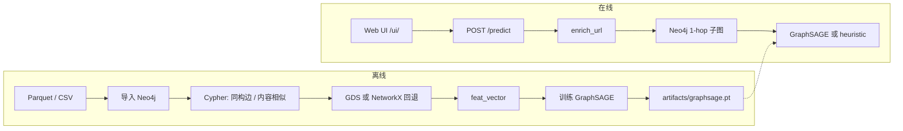

# crypo-side

**欺诈网站图检测原型（Fraud website graph detection prototype）**

以 Neo4j 构建知识图谱，结合 Neo4j GDS（或 NetworkX 回退）图特征、Sentence Transformers 文本嵌入与 **GraphSAGE（SAGEConv 图卷积）** 对 URL 输出欺诈概率；提供 **Web 分析界面**（`/ui/`）与 FastAPI 接口。

---

## 快速开始

```powershell
# 1. 安装依赖
cd e:\crypo-side
python -m venv .venv
.\.venv\Scripts\Activate.ps1
pip install -r requirements.txt
pip install -e .

# 2. 配置 .env（Neo4j 账号密码等），并启动 Neo4j（Bolt 7687）
#    Windows 示例：D:\neo4j-community-5.15.0\bin\neo4j.bat console

# 3. 检查连通性
python scripts/check_deps.py
curl http://127.0.0.1:8000/health   # 需先启动 API

# 4. 启动服务并打开 Web UI
uvicorn crypo_side.api.main:app --reload
# 浏览器访问 http://127.0.0.1:8000/ui/
```

首次使用需先完成 [离线流水线](#流水线pipeline)（导入数据、图特征、训练 `artifacts/graphsage.pt`），否则在线检测会退化为 **启发式** 模式。

---

## 目录

- [架构概览](#架构概览)
- [项目结构](#项目结构)
- [环境要求](#环境要求)
- [安装与配置](#安装与配置)
- [流水线（Pipeline）](#流水线pipeline)
- [CLI 脚本](#cli-脚本)
- [Web UI](#web-ui)
- [API](#api)
- [检测引擎说明](#检测引擎说明)
- [Neo4j 图模型](#neo4j-图模型)
- [数据格式](#数据格式)
- [核心模块](#核心模块crypo_side)
- [Cypher 脚本](#cypher-脚本)
- [Neo4j GDS 安装](#neo4j-gds-安装)
- [常见问题](#常见问题)

---

## 架构概览



| 层次 | 技术 | 作用 |
|------|------|------|
| 图存储 | Neo4j 5.x | Website、IP、NS、WHOIS 邮箱等节点与关系 |
| 图特征 | GDS 2.7 / NetworkX + TruncatedSVD | PageRank、Louvain 等，与 `text_embedding` 拼接为 `feat_vector` |
| 文本嵌入 | sentence-transformers（`all-MiniLM-L6-v2`，384 维） | 来自页面可见文本或域名 |
| 机器学习 | PyTorch Geometric **GraphSAGE（`SAGEConv` 图卷积）** | 二分类 `fraud` / `normal` |
| 前端 | `static/` + vis-network | VirusTotal 风格：搜索、风险环、关系图、详情 |
| 服务 | FastAPI + Uvicorn | `/predict`、`/graph`、`/health`、`/docs`、`/ui/` |

---

## 项目结构

```
crypo-side/
├── crypo_side/                 # 核心 Python 包
│   ├── config.py               # Settings（.env）
│   ├── db.py                   # Neo4j driver
│   ├── collection/enrich.py    # URL 采集：HTTP、DNS、WHOIS、SSL
│   ├── dataset/deepurl.py      # Parquet 加载与标签映射
│   ├── graph/                  # 导入、Cypher、GDS 回退
│   ├── ml/                     # 嵌入、GraphSAGE、训练
│   └── api/                    # FastAPI + 推理
├── scripts/                    # 流水线 CLI
├── resources/cypher/           # Neo4j 分步脚本
├── static/                     # Web UI
│   ├── index.html
│   ├── css/app.css
│   └── js/app.js
├── artifacts/                  # graphsage.pt、GDS 插件说明
├── data/seed_example.csv
├── pyproject.toml
├── requirements.txt
└── README.md
```

---

## 环境要求

- **Python** ≥ 3.10
- **Neo4j** 5.x（推荐 5.15 + GDS 2.7，见 [artifacts/neo4j-plugins/GDS_INSTALL.txt](artifacts/neo4j-plugins/GDS_INSTALL.txt)）
- **Neo4j 必须先启动**：Bolt 默认 `localhost:7687`；未启动时 `/predict` 返回 **503**
- **内存**：训练与 `sentence-transformers` 需一定 RAM；大数据集使用 `--chunk-rows` 流式导入
- **Parquet**（完整流水线）：目录见 `DEEPURL_PARQUET_DIR`（默认 `urls_with_dns_live_mixed/parts`，需自备）

---

## 安装与配置

### 安装

```powershell
cd e:\crypo-side
python -m venv .venv
.\.venv\Scripts\Activate.ps1
pip install -r requirements.txt
pip install -e .
python scripts/check_deps.py
```

### `.env` 示例

仓库提供 `.env.example`，复制为 `.env` 后填写：

```powershell
Copy-Item .env.example .env
```

```env
NEO4J_URI=bolt://localhost:7687
NEO4J_USER=neo4j
NEO4J_PASSWORD=your_password

DEEPURL_PARQUET_DIR=urls_with_dns_live_mixed/parts
EMBEDDING_MODEL=sentence-transformers/all-MiniLM-L6-v2
EMBEDDING_DIM=384
VECTOR_INDEX_NAME=content_vec_idx
GNN_CHECKPOINT=artifacts/graphsage.pt
RANDOM_STATE=42
GRAPH_WEBSITE_HOMOG_EDGES=SHARED_IP|CONTENT_SIMILAR
```

| 变量 | 默认值 | 说明 |
|------|--------|------|
| `NEO4J_URI` | `bolt://localhost:7687` | Neo4j Bolt 地址 |
| `NEO4J_USER` / `NEO4J_PASSWORD` | `neo4j` / `""` | 认证 |
| `DEEPURL_PARQUET_DIR` | `urls_with_dns_live_mixed/parts` | Parquet 目录 |
| `GNN_CHECKPOINT` | `artifacts/graphsage.pt` | GraphSAGE 权重路径 |
| `GRAPH_WEBSITE_HOMOG_EDGES` | `SHARED_IP\|CONTENT_SIMILAR` | 同构边类型（竖线分隔） |

---

## 流水线（Pipeline）

### 一键全流程

```powershell
python scripts/run_full_pipeline.py --data-dir path\to\parquet\parts
```

顺序：`schema` → 导入 Parquet → `homog` + `similar` → `graph_features` → 训练 GraphSAGE。

| 参数 | 含义 |
|------|------|
| `--wipe` | 清空图库（仅开发环境） |
| `--skip-ingest` / `--skip-gds` / `--skip-train` | 跳过对应步骤 |
| `--epochs N` | 训练轮数（默认 120） |
| `--gds-projection minimal\|full` | GDS 投影模式 |

### 分步执行

```powershell
python scripts/neo4j_apply.py schema
python scripts/ingest_parquet_dataset.py --data-dir path\to\parts --chunk-rows 8192
python scripts/neo4j_apply.py homog
python scripts/neo4j_apply.py similar
python scripts/neo4j_apply.py graph_features --gds-projection minimal
python -m crypo_side.ml.train --epochs 200 --device cpu
```

---

## CLI 脚本

| 脚本 | 说明 |
|------|------|
| `run_full_pipeline.py` | 离线全流程 |
| `neo4j_apply.py` | `schema` / `homog` / `similar` / `graph_features` / `all` |
| `ingest_parquet_dataset.py` | Parquet 批量导入 + 嵌入 |
| `ingest_csv.py` | CSV（`url,label`）+ HTTP 丰富 |
| `wipe_graph.py --yes` | 清空图库 |
| `check_deps.py` | 依赖检查 |

---

## Web UI

访问：**http://127.0.0.1:8000/ui/**（需先 `uvicorn crypo_side.api.main:app --reload`）

界面参考 VirusTotal 布局，主要能力：

| 功能 | 说明 |
|------|------|
| URL 搜索栏 | 输入 URL 或域名，一键「分析」 |
| 风险环与徽章 | 欺诈概率 0–100%；低风险 / 可疑 / 高风险 |
| 统计行 | 欺诈概率、检测引擎、欺诈邻居数、Louvain 社区 |
| 关系图 | 调用 `/graph`，vis-network 展示 1-hop 子图（无需浏览器连接 Neo4j） |
| 详情 / JSON | 检测模式、模型说明、原始 API 响应 |

支持查询参数预填：`/ui/?url=https://example.com`

静态资源：

- `static/index.html` — 页面结构
- `static/css/app.css` — 样式
- `static/js/app.js` — 调用 `/predict`、`/graph`

---

## API

### 启动

```powershell
uvicorn crypo_side.api.main:app --reload --host 127.0.0.1 --port 8000
```

### 接口一览

| 方法 | 路径 | 说明 |
|------|------|------|
| GET | `/` | API 说明与链接 |
| GET | `/health` | 服务与 **Neo4j 连通性**（`neo4j`、`neo4j_error`） |
| POST | `/predict` | 预测欺诈概率 |
| GET | `/graph?domain=...` | 导出 1-hop 子图 JSON |
| GET | `/docs` | Swagger UI |
| GET | `/ui/` | Web 分析界面 |

### `GET /health` 示例

```json
{
  "ok": true,
  "neo4j": true,
  "neo4j_uri": "bolt://localhost:7687",
  "neo4j_error": null
}
```

`ok` / `neo4j` 为 `false` 时表示 Neo4j 未启动或配置错误。

### `POST /predict`

请求：

```json
{ "url": "https://example.com", "label": null }
```

响应字段：

| 字段 | 含义 |
|------|------|
| `fraud_probability` | 0–1，越大越可疑 |
| `mode` | `gnn`：GraphSAGE 推理；`heuristic`：无权重时的启发式 |
| `gang_hint` | 如 `louvain:1244,fraud_neighbors:0` |

流程：`enrich_url` → 写入 Neo4j → 文本嵌入 → 子图 GraphSAGE 或启发式 → 回写 `gnn_fraud_prob`。

Neo4j 不可用时返回 **503**，提示检查数据库与 `.env`。

---

## 检测引擎说明

| 名称 | 含义 |
|------|------|
| **GraphSAGE** | 项目使用的 GNN 架构（`crypo_side/ml/graphsage.py`） |
| **SAGEConv** | PyG 图卷积层，对邻居特征聚合，即「图卷积」实现 |
| **API `mode: gnn`** | 表示已用训练好的 GraphSAGE 权重推理（非泛指所有 GNN） |
| **启发式 `heuristic`** | 无 `graphsage.pt` 时，按欺诈邻居比例粗估 |

Web UI 中「检测引擎」在 `gnn` 模式下显示为 **图卷积**（对应 GraphSAGE / SAGEConv）。

---

## Neo4j 图模型

### 节点（主要）

| Label | 关键属性 |
|-------|----------|
| `Website` | `url`、`domain`、`label`、`text_embedding`、`feat_vector`、`louvain_community`、`gnn_fraud_prob` |
| `IP` | `address` |
| `NameServer` | `ns_name` |
| `RegistrantEmail` | `email` |

### 关系（示例）

| 类型 | 说明 |
|------|------|
| `HAS_IP`、`USES_NS`、`REGISTERED_BY` 等 | Website 与基础设施实体 |
| `SHARED_IP`、`SHARED_EMAIL`、`SHARED_NS` | 网站间共享基础设施 |
| `CONTENT_SIMILAR` | 内容向量相似 |

`feat_vector` = GDS/NetworkX 结构特征 + `text_embedding`（384 维），见 `06_feat_vector_concat.cypher`。

---

## 数据格式

### Parquet（DeepURLBench 风格）

列：`url`、`label`、`ip_address`

| 原始标签 | 图中标签 |
|----------|----------|
| `phishing`、`malware`、`defacement`、`spam` | `fraud` |
| `benign`、`normal` | `normal` |

### 示例 CSV

见 `data/seed_example.csv`（列 `url,label`）。

---

## 核心模块（`crypo_side`）

| 模块 | 职责 |
|------|------|
| `api/main.py` | FastAPI、`/health` Neo4j 探测、`/predict` |
| `api/infer.py` | GraphSAGE 子图推理、启发式、子图导出 |
| `ml/graphsage.py` | `FraudGraphSAGE`（`SAGEConv`） |
| `ml/train.py` | 分层训练、早停、保存 checkpoint |
| `graph/feature_fallback.py` | 无 GDS 时用 NetworkX |
| `collection/enrich.py` | 在线 URL 丰富化 |

训练示例：

```powershell
python -m crypo_side.ml.train --epochs 200 --device cpu --split-mode stratified
```

---

## Cypher 脚本

| 文件 | 作用 |
|------|------|
| `01_schema.cypher` | 约束、向量索引 |
| `02_project_homogeneous.cypher` | `SHARED_*` 边 |
| `03_gds_project*.cypher` | GDS 投影 |
| `04_gds_features.cypher` | PageRank、Louvain 等 |
| `05_content_similar.cypher` | `CONTENT_SIMILAR` |
| `06_feat_vector_concat.cypher` | `feat_vector` 拼接 |

---

## Neo4j GDS 安装

1. 复制 `artifacts/neo4j-plugins/neo4j-graph-data-science-2.7.0.jar` 到 Neo4j `plugins/`
2. `neo4j.conf`：`dbms.security.procedures.unrestricted=gds.*`
3. 重启后：`RETURN gds.version();`
4. `python scripts/neo4j_apply.py graph_features`

详见 [artifacts/neo4j-plugins/GDS_INSTALL.txt](artifacts/neo4j-plugins/GDS_INSTALL.txt)。无 GDS 时自动走 NetworkX 回退。

### 启动 Neo4j（Windows 示例）

```powershell
D:\neo4j-community-5.15.0\bin\neo4j.bat console
# 或安装为服务后：neo4j.bat start
```

---

## 常见问题

| 现象 | 处理 |
|------|------|
| `Couldn't connect to localhost:7687` / WinError 10061 | 启动 Neo4j；访问 `/health` 确认 `neo4j: true` |
| `/predict` 返回 503 | 同上，检查 `.env` 中 URI 与密码 |
| `没有带 feat_vector 与 label 的 Website` | 完成 ingest + `graph_features`，节点需有 `label` |
| 界面显示「启发式」而非图卷积 | 训练并放置 `artifacts/graphsage.pt` |
| `graphsage.pt` 不存在 | 运行 `crypo_side.ml.train` 或完整 pipeline |
| CUDA 不可用 | 训练加 `--device cpu` |
| 同构边与训练不一致 | 调整 `GRAPH_WEBSITE_HOMOG_EDGES` 与 Cypher 创建的边一致 |
| UI 仍显示旧版 Neovis | 强制刷新（Ctrl+F5）；确认访问 `/ui/` 而非旧书签 |

---

## 版本

- 包版本：`0.1.0`
- 描述：Fraud website graph detection prototype

---

## 数据与模型可用性

### 数据集

`urls_with_dns_live_mixed/parts/` 中的 Parquet 为 **DeepURLBench** 数据集的**子集**（500 条：150 条 phishing + 350 条 benign），用于复现本项目的实验结果。

- 原始数据集：Deep Instinct 研究团队，论文 *A New Dataset and Methodology for Malicious URL Classification*
- 原始字段：`url`、`first_seen`、`TTL`、`label`、`ip_address`
- **授权：CC BY-NC 4.0**（署名—非商业性使用），详见 [urls_with_dns_live_mixed/README.md](urls_with_dns_live_mixed/README.md)
- 本仓库仅做非商业性学术研究使用；如需完整数据请从原始来源获取

标签映射：`phishing` / `malware` / `defacement` / `spam` → `fraud`；`benign` / `normal` → `normal`。

### 文本嵌入模型

`sentence-transformers/all-MiniLM-L6-v2`（384 维）**未包含在仓库中**，首次运行 `embed_texts()` 时由 sentence-transformers 自动从 HuggingFace 下载到本地缓存。离线环境可预先手动下载：

```powershell
python -c "from sentence_transformers import SentenceTransformer; SentenceTransformer('sentence-transformers/all-MiniLM-L6-v2')"
```

> 注意：`config.py` 默认的 `embedding_model` 是 HuggingFace 仓库名，并非本地目录。仓库中不保存模型权重副本。

### Neo4j GDS 插件

`artifacts/neo4j-plugins/neo4j-graph-data-science-2.7.0.jar`（约 55.6 MB）随仓库提供，方便开箱使用；安装方法见 [artifacts/neo4j-plugins/GDS_INSTALL.txt](artifacts/neo4j-plugins/GDS_INSTALL.txt)。该插件归 Neo4j 所有，遵循其官方许可。

### 训练好的模型权重

`artifacts/graphsage.pt` **不随仓库提供**，需自行训练生成：

```powershell
python -m crypo_side.ml.train --epochs 200 --device cpu
```

训练完成前，`/predict` 会以 `mode=heuristic` 运行（按欺诈邻居比例粗估）；训练后放置到 `artifacts/graphsage.pt`，即切换为 `mode=gnn`（GraphSAGE 推理）。

---

## 许可说明

本项目代码为 **研发原型**，未在 `pyproject.toml` 中声明许可证；生产使用请按组织政策自行补充。

第三方资源遵循各自授权：

| 资源 | 授权 |
|------|------|
| DeepURLBench 数据集 | CC BY-NC 4.0（禁止商业使用） |
| all-MiniLM-L6-v2 | Apache 2.0 |
| Neo4j Graph Data Science | Neo4j 官方许可 |
| vis-network（前端） | MIT |

